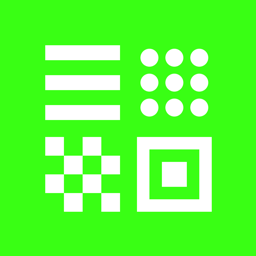
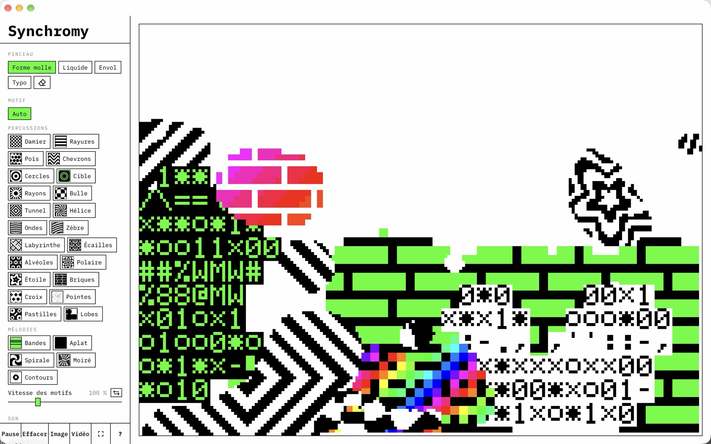
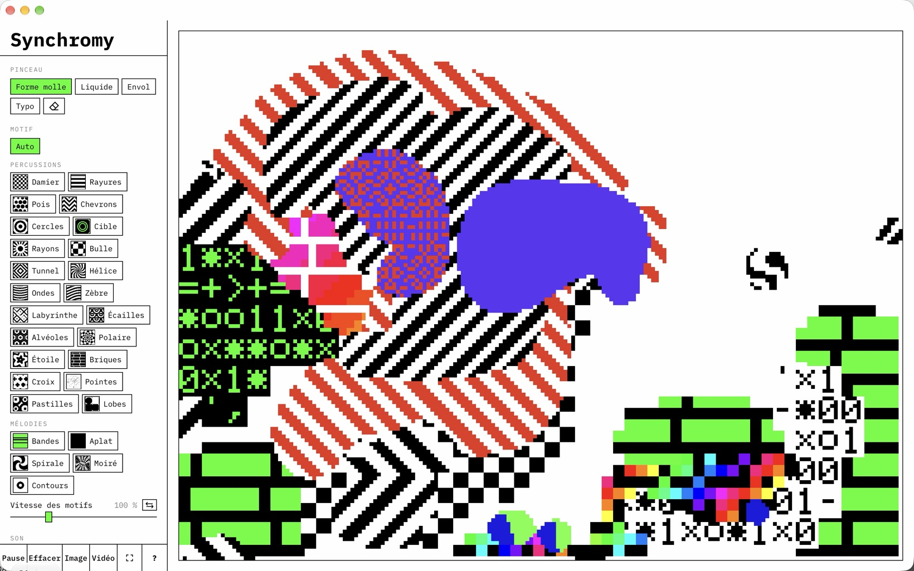
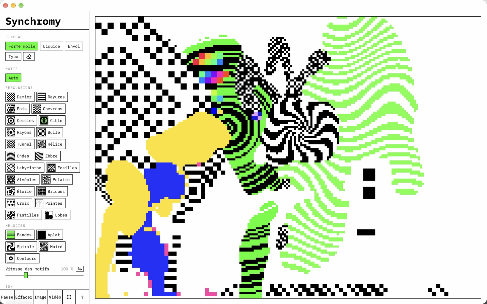

<div align="center">



# Synchromy

**Dessiner, c’est jouer.** Un outil génératif d’image et de musique où chaque trait est à la fois une forme et un son.

[**Ouvrir l’outil**](https://etienne.design/tools/synchromy/) · [English version](README.md) · [Journal des versions](CHANGELOG.md)



</div>

## À propos

Synchromy est un hommage à *Synchromy* (1971), le film de Norman McLaren produit par l’Office national du film du Canada, où les mêmes bandes font l’image et le son : on voit ce que l’on entend.

Ici, chaque trait dépose une forme molle qui coule, sèche et sonne. Le motif choisit l’instrument, la hauteur donne la note, la couleur la tonalité, la position le moment dans la mesure. Tout est calculé en direct, dans le navigateur, sans serveur ni compte.

Conçu par [Etienne Mineur](https://etienne.design).

## Ce que fait l’outil

- **Le dessin comme instrument.** 44 motifs animés, chacun avec sa voix : 37 percussions, 7 mélodies. Pinceaux forme molle, liquide, lettres, envol et gomme.
- **Une matière physique.** Les formes s’affaissent, gouttent, sèchent, s’entassent sur un sol, rebondissent et se heurtent ; tout choc fait un son, calé sur le tempo.
- **Des styles de partition.** Libre, minimal, drum and bass, jungle, 8 bits, house, dub, hip-hop, afro 12/8, gamelan, bossa nova, ambient, concret et data.
- **13 familles d’instruments de synthèse**, des objets résonants et cordes pincées au chœur sans paroles, au gamelan et au métal liquide.
- **Dessin automatique.** La machine dessine, compose et change de tableau seule, avec des tableaux typographiques.
- **Deux sets.** *make me dance*, un set mixé de jungle anglaise des années 90 sur des breakbeats originaux, et *make me happy*, uptempo à 205 bpm.
- **Interface en français et en anglais**, changée sur place.
- **Export** en image PNG, en vidéo avec le son, ou en page HTML autonome qui se rejoue seule.
- **Aucune dépendance à l’exécution.** Un seul fichier HTML : JavaScript sans bibliothèque, rendu logiciel des pixels, Web Audio, et une chaîne de mastering écrite en Faust et compilée en WebAssembly.

<p align="center">
 
</p>

> [!WARNING]
> *make me dance* et *make me happy* utilisent des effets stroboscopiques. À éviter en cas de sensibilité aux lumières clignotantes.

## L’utiliser

| Plateforme | Comment |
| --- | --- |
| Web | [etienne.design/tools/synchromy](https://etienne.design/tools/synchromy/), dans tout navigateur récent, ordinateur ou mobile |
| Apple TV | [App Store](https://apps.apple.com/fr/app/synchromy/id6835873161) |
| App Mac, économiseur d’écran Mac, app et économiseur Windows | à construire depuis ce dépôt, voir ci-dessous |

## Organisation du dépôt

```
web/                      l’outil web
  synchromy.html          source en un seul fichier : page, styles, programme, polices, banques de sons
  build.py                le découpe en fichiers à servir
native/
  engine/                 le moteur de dessin et de musique en C, commun aux versions natives
  macos-app/              app Mac : une fenêtre native autour de l’outil web (WKWebView)
  macos-screensaver/      économiseur d’écran Mac (moteur C)
  tvos-app/               app Apple TV (moteur C)
  windows/                app et économiseur Windows (moteur C, Win32)
tools/
  faust/                  la chaîne de mastering (source Faust)
  samples/                la fabrication des banques de sons depuis leurs sources CC0
docs/                     les images de cette page
```

## Construire

### Web

`web/synchromy.html` est l’outil entier : ouvert dans un navigateur, il fonctionne. Rien à installer.

Pour produire la version publiée (programme minifié, banques de sons et polices en fichiers séparés, pages française et anglaise) :

```sh
cd web
npm ci                  # installe terser, une fois
python3 build.py dist   # écrit dist/
```

Le dossier `dist/` se sert avec n’importe quel serveur de fichiers statiques. `python3 build.py dist --readable` laisse le programme tel qu’il est écrit et ne demande que Python.

### App et économiseur Windows

Compilation croisée avec mingw-w64, depuis macOS (`brew install mingw-w64`) ou Linux (`apt install gcc-mingw-w64-x86-64 zip`) :

```sh
sh native/windows/build.sh   # écrit native/windows/build/Synchromy-Windows.zip
```

### Économiseur d’écran Mac

Demande les outils en ligne de commande de Xcode.

```sh
sh native/macos-screensaver/build.sh             # écrit build/Synchromy.saver
sh native/macos-screensaver/build.sh --install   # et l’installe pour l’utilisateur courant
```

### App Mac et app Apple TV

Demandent Xcode et [XcodeGen](https://github.com/yonaskolb/XcodeGen) (`brew install xcodegen`). Les projets Xcode sont générés, pas versionnés.

```sh
cd native/macos-app && xcodegen generate && open SynchromyMac.xcodeproj
cd native/tvos-app  && xcodegen generate && open SynchromyTV.xcodeproj
```

Indiquez votre équipe Apple et votre identifiant d’app dans `project.yml` avant de lancer sur un appareil ou de distribuer. Le dépôt ne contient aucun élément de signature.

## Fonctionnement

L’outil web tient en une page autonome. Un seul programme JavaScript simule la matière sur une grille de pixels, la dessine par calcul dans une `ImageData`, et la joue avec Web Audio : tous les instruments sont synthétisés, seuls les deux sets utilisent de courts échantillons de batterie, stockés en FLAC sans perte et décodés à la demande. La sortie passe par une chaîne de mastering (réverbération, compression multibande, écrêteur doux sans repliement, limiteur à anticipation) écrite en Faust et compilée en WebAssembly.

Le moteur natif de `native/engine` est le portage de ce programme en C, fonction par fonction, avec sa propre synthèse sonore. Il anime les économiseurs d’écran, l’app Apple TV et l’app Windows.

Les commentaires du code sont en français.

## Contribuer

Les signalements de bogues et les suggestions sont bienvenus : voir [CONTRIBUTING.md](CONTRIBUTING.md). Pour la sécurité, voir [SECURITY.md](SECURITY.md).

## Crédits

Conception et direction : Etienne Mineur.

Synchromy utilise IBM Plex Mono (SIL Open Font License 1.1), des échantillons de batterie du domaine public (CC0) et les bibliothèques Faust. Le détail figure dans [THIRD_PARTY_NOTICES.md](THIRD_PARTY_NOTICES.md).

Ce projet est un hommage indépendant. Il n’est ni affilié à l’Office national du film du Canada ou aux ayants droit de Norman McLaren, ni approuvé par eux, et ne contient aucun élément du film.

## Licence

[MIT](LICENSE) © 2026 Etienne Mineur
