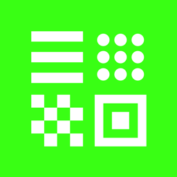
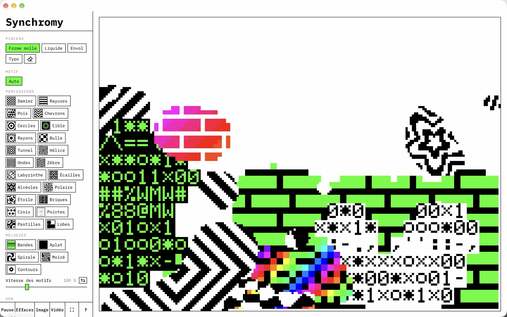
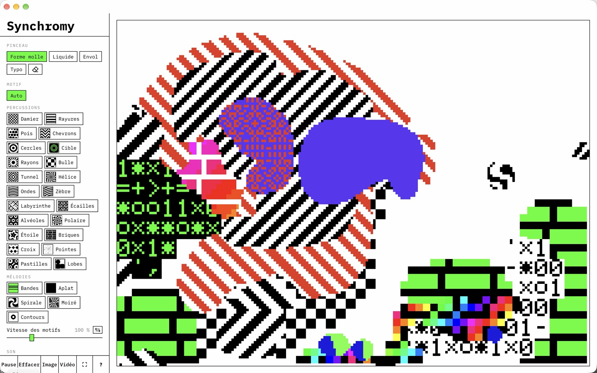
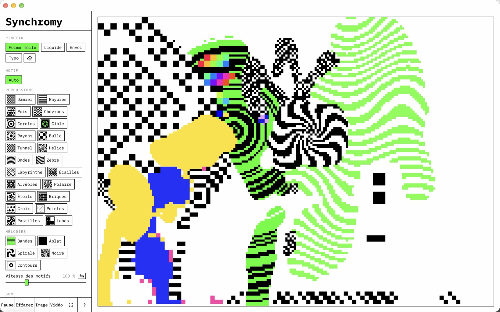

<div align="center">



# Synchromy

**To draw is to play.** A generative drawing and music tool in which every stroke is both a shape and a sound.

[**Open the tool**](https://etienne.design/tools/synchromy/en/) · [Version française](README.fr.md) · [Changelog](CHANGELOG.md)

[](LICENSE)
[](https://github.com/etiennemineur/synchromy/releases)



</div>

## About

Synchromy is a tribute to *Synchromy* (1971), the film by Norman McLaren produced by the National Film Board of Canada, in which the same strips make both the picture and the sound: you see what you hear.

Here, every stroke lays down a soft shape that runs, dries and sounds. The pattern picks the instrument, the height gives the note, the color the key, the position the moment in the bar. Everything is computed live, in the browser, with no server and no account.

Designed by [Etienne Mineur](https://etienne.design).

## Features

- **Drawing as an instrument.** 44 animated patterns, each with its own voice: 37 percussion, 7 melodies. Soft shapes, liquid, type, lift-off and eraser brushes.
- **A physical material.** Shapes sag, drip, dry, pile up on a floor, bounce and collide; whatever hits something makes a sound, locked to the tempo.
- **Score styles.** Free, minimal, drum and bass, jungle, 8-bit, house, dub, hip-hop, Afro 12/8, gamelan, bossa nova, ambient, concrete and data.
- **13 synthesized instrument families**, from resonant objects and plucked strings to wordless choir, gamelan and liquid metal.
- **Auto-draw.** The machine draws, composes and changes scene on its own, including typographic scenes.
- **Two sets.** *make me dance*, a mixed set of 90s UK jungle on original breakbeats, and *make me happy*, uptempo at 205 bpm.
- **French and English** interface, switched in place.
- **Export** as a PNG image, a video with sound, or a standalone HTML page that replays on its own.
- **No dependencies at run time.** One HTML file: vanilla JavaScript, a software pixel renderer, Web Audio, and a mastering chain written in Faust and compiled to WebAssembly.

<p align="center">
 
</p>

> [!WARNING]
> *make me dance* and *make me happy* use strobe effects. Avoid them if you are sensitive to flashing light.

## Use it

| Platform | How |
| --- | --- |
| Web | [etienne.design/tools/synchromy](https://etienne.design/tools/synchromy/en/), in any recent browser, desktop or mobile |
| Apple TV | [App Store](https://apps.apple.com/app/synchromy/id6835873161) |
| macOS app, macOS screen saver, Windows app and screen saver | build from this repository, see below |

## Repository layout

```
web/                      the web tool
  synchromy.html          single-file source: markup, styles, program, fonts, sound banks
  build.py                splits it into the files a web server delivers
native/
  engine/                 the drawing and music engine in C, shared by the native targets
  macos-app/              macOS app: a native window around the web tool (WKWebView)
  macos-screensaver/      macOS screen saver (C engine)
  tvos-app/               Apple TV app (C engine)
  windows/                Windows app and screen saver (C engine, Win32)
tools/
  faust/                  the mastering chain (Faust source)
  samples/                how the sound banks were derived from their CC0 sources
docs/                     images used by this page
```

## Build

### Web

`web/synchromy.html` is the whole tool: open it in a browser and it runs. Nothing to install.

To produce the published version (minified program, sound banks and fonts as separate files, French and English pages):

```sh
cd web
npm ci                  # installs terser, once
python3 build.py dist   # writes dist/
```

Serve `dist/` with any static web server. `python3 build.py dist --readable` skips minification and needs only Python.

### Windows app and screen saver

Cross-compiled with mingw-w64 from macOS (`brew install mingw-w64`) or Linux (`apt install gcc-mingw-w64-x86-64 zip`):

```sh
sh native/windows/build.sh   # writes native/windows/build/Synchromy-Windows.zip
```

### macOS screen saver

Requires the Xcode command line tools.

```sh
sh native/macos-screensaver/build.sh             # writes build/Synchromy.saver
sh native/macos-screensaver/build.sh --install   # and installs it for the current user
```

### macOS app and Apple TV app

Requires Xcode and [XcodeGen](https://github.com/yonaskolb/XcodeGen) (`brew install xcodegen`). The Xcode projects are generated, not committed.

```sh
cd native/macos-app && xcodegen generate && open SynchromyMac.xcodeproj
cd native/tvos-app  && xcodegen generate && open SynchromyTV.xcodeproj
```

Set your own Apple team and bundle identifier in `project.yml` before running on a device or distributing. No signing material is stored in this repository.

## How it works

The web tool is one self-contained page. A single JavaScript program simulates the material on a pixel grid, renders it in software into an `ImageData`, and plays it through Web Audio: every instrument is synthesized, and only the two sets use short drum samples, stored as lossless FLAC and decoded on demand. The output goes through a mastering chain (send reverb, multiband compression, alias-free soft clipper, look-ahead limiter) written in Faust and compiled to WebAssembly.

The native engine in `native/engine` is a port of that program to C, function by function, with its own audio synthesis. It drives the screen savers, the Apple TV app and the Windows app.

Source comments are written in French.

## Contributing

Bug reports and suggestions are welcome: see [CONTRIBUTING.md](CONTRIBUTING.md). For security matters, see [SECURITY.md](SECURITY.md).

## Credits

Design and direction: Etienne Mineur.

Synchromy uses IBM Plex Mono (SIL Open Font License 1.1), public-domain (CC0) drum samples, and the Faust libraries. Full details in [THIRD_PARTY_NOTICES.md](THIRD_PARTY_NOTICES.md).

This project is an independent tribute. It is not affiliated with, or endorsed by, the National Film Board of Canada or the estate of Norman McLaren, and contains no material from the film.

## License

[MIT](LICENSE) © 2026 Etienne Mineur
